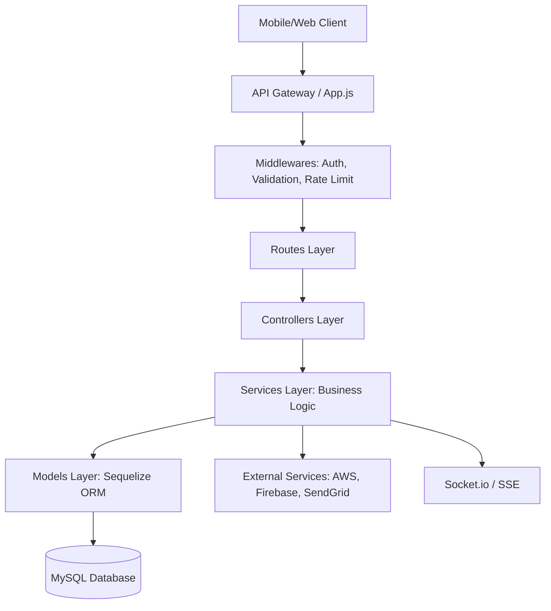

# Project Architecture Documentation: MCC Profile Management API

This document provides a comprehensive overview of the architecture, design patterns, and technologies used in the `mcc_profile_management_api` repository. This is intended to serve as a blueprint for building similar robust Node.js backend applications.

---

## 🏗️ Architecture Overview

The project follows a **Layered Architecture** pattern (also known as N-Tier architecture), which separates concerns into distinct layers.

### System Architecture Diagram


### Data Flow
1. **Request**: An HTTP request enters the system through `server.js` and `app.js`.
2. **Routing**: The `Routes` layer identifies the endpoint and passes the request through **Middlewares** (Authentication, Validation).
3. **Controller**: The `Controller` layer handles the request/response logic. It extracts data from the request and calls the appropriate Service.
4. **Service**: The `Service` layer contains the **Business Logic**. It performs calculations, interacts with external APIs, and communicates with the Models.
5. **Model**: The `Model` layer (Sequelize) interacts with the Database and returns data to the Service.
6. **Response**: The Service returns data to the Controller, which sends the final HTTP response to the client.

---

## 📂 Folder Structure

The project is organized in a way that separates logic by responsibility:

```text
mcc_profile_management_api/
├── app.js                  # Express app configuration
├── server.js               # Entry point (Server initialization)
├── .env                    # Environment variables (Sensitive)
├── src/
│   ├── routes/             # API Endpoints
│   │   └── v1/             # Versioning of APIs
│   ├── controllers/        # Request handling
│   ├── services/           # Business Logic
│   ├── models/             # Sequelize Data Models
│   ├── middlewares/        # Security & Auth
│   ├── validations/        # Joi schemas
│   ├── utilities/          # Global utils (Logger, etc.)
│   ├── websockets/         # Real-time WebSockets
│   └── config/             # Database & global constants
├── db/                     # SQL scripts & seed data
├── tests/                  # Jest test cases
└── mcc-profile-mgmt-logs/  # Generated Log files
```

---

## 📦 Key Dependencies & Their Roles

### Core Web Framework
- **`express`**: The primary web framework for building the REST API.
- **`cors`**: Middleware to enable Cross-Origin Resource Sharing.
- **`helmet`**: Enhances security by setting various HTTP headers.
- **`express-rate-limit`**: Protects the API from brute-force attacks and DDoS.

### Database & ORM
- **`sequelize`**: A promise-based Node.js ORM for MySQL. It allows us to interact with the database using Javascript objects.
- **`mysql2`**: The underlying driver for MySQL database connection.

### Security & Authentication
- **`jsonwebtoken (JWT)`**: Used for stateless authentication between the client and server.
- **`bcrypt`**: A library to help hash passwords for secure storage.
- **`joi`**: A powerful schema description language for validating request payloads.

### Logging & Monitoring
- **`winston`**: A versatile logging library.
- **`winston-daily-rotate-file`**: A transport for Winston to log to files that rotate daily.
- **`moment-timezone`**: For precise timestamping in logs across different time zones.

---

## ⚙️ Centralized Configuration

Effective environment management is key to a professional application. Instead of using `process.env` directly everywhere, this project centralizes all configuration in one place.

**Location**: `src/config/config.js`

This file organizes settings for different environments (**local**, **development**, **preprod**, **production**).

```javascript
require('dotenv').config();

const config = {
  local: {
    username: process.env.DB_USER,
    password: process.env.DB_PASS,
    database: process.env.DB_NAME,
    host: process.env.DB_HOST,
    dialect: 'mysql'
  },
  production: {
    username: process.env.DB_USER,
    password: process.env.DB_PASS,
    database: process.env.DB_NAME,
    host: process.env.DB_HOST,
    dialect: 'mysql'
  }
};

module.exports = config;
```

### 💡 Why Centralize Config?
1. **Switching Environments**: Easily switch between local and production databases by changing a single `NODE_ENV` variable.
2. **Default Values**: You can provide fallback values (e.g., `port: process.env.DB_PORT || 3307`).
3. **Clean Code**: Your business logic remains clean and isn't cluttered with `process.env` calls.

---

## 📝 Logging System (Winston)

The logging system is a critical part of the application for debugging and auditing.

**Implementation**: `src/utilities/logger.js`

- **Console Transport**: Outputs logs to the terminal during development.
- **File Transport**: Saves logs to the `mcc-profile-mgmt-logs` directory.
- **Daily Rotation**: Files are named by date (e.g., `2024-04-12.log`) and kept for 60 days.
- **Format**: Custom formatting includes a timestamp (Kolkata timezone) and the message.

**How to use in code**:
```javascript
const logger = require('./src/utilities/logger');

// Logging info
logger.info('"file_name","function_name","Action performed successfully"');

// Logging errors
logger.error(`"file_name","function_name","Error occurred: ${error.message}"`);
```

---

## 🗄️ Database & Models

We use **Sequelize ORM** to manage the database.

- **Models**: Defined in `src/models/`. Each file represents a table (e.g., `userProfile.model.js`).
- **Associations**: Defined in `src/models/index.js`. This manages relationships like `One-to-Many` (e.g., a Company has many UserProfiles).
- **Initialization**: `server.js` authenticates the connection and synchronizes models on startup.

---

## 🔐 Security Best Practices

1. **Environment Variables**: Sensitive data (DB credentials, JWT secrets) are stored in a `.env` file and never committed to version control.
2. **Content Security Policy (CSP)**: Managed via `helmet` in `app.js` to prevent XSS attacks.
3. **Hidden Headers**: Using `app.disable('x-powered-by')` and removing the `Server` header to hide technology stack details from attackers.
4. **Rate Limiting**: Applied to sensitive endpoints to prevent abuse.
5. **Request Validation**: Every request is validated using `Joi` schemas before reaching the controller.

---

## 🚀 Key Entry Points

- **`server.js`**: The starting point of the application. It initializes the database, Firebase, Sockets, and starts the Express server.
- **`app.js`**: Configures the Express application, applies global middlewares, and registers all routes.
- **`cron.js`**: Handles scheduled background tasks (e.g., periodic data cleanup or sync).

---

## 💻 Code Reference Examples

To help you build your project, here is how a single feature (like "User Profile") is spread across the layers:

### 1. The Model (Database Design)
Located in `src/models/userProfile.model.js`. This defines how your table looks in MySQL.

```javascript
const { DataTypes } = require('sequelize');
const db = require('../config/sequelize.js');

const UserProfile = db.define('mcc_user_profiles', {
  profileId: {
    type: DataTypes.INTEGER,
    allowNull: false,
    unique: true
  },
  userName: {
    type: DataTypes.STRING(255),
    allowNull: false
  },
  emailAddress: {
    type: DataTypes.STRING(255),
    allowNull: true,
    unique: true
  },
  password: {
    type: DataTypes.STRING(255),
    allowNull: false
  }
}, {
  tableName: 'mcc_user_profiles',
  timestamps: false
});

module.exports = UserProfile;
```

### 2. The Route (The Endpoint)
Located in `src/routes/v1/auth.route.js`. This maps a URL to a controller function.

```javascript
const express = require('express');
const authController = require('../../controllers/authController');
const authMiddleware = require('../../middlewares/auth');

const router = express.Router();

router.post('/login', authController.login);
router.get('/me', authMiddleware, authController.getMe); // Using middleware for protection

module.exports = router;
```

### 3. The Controller (Handling the Request)
Located in `src/controllers/authController.js`. It talks to the Service.

```javascript
const authService = require('../services/authService');
const logger = require('../utilities/logger');

const login = async (req, res) => {
  try {
    const { email, password } = req.body;
    const result = await authService.loginWithEmail(email, password);
    res.status(200).send(result);
  } catch (error) {
    logger.error(`"authController.js","login()","Error: ${error.message}"`);
    res.status(401).send({ message: 'Invalid credentials' });
  }
};
```

### 4. The Service (The Brain)
Located in `src/services/authService.js`. This does the actual work.

```javascript
const { UserProfile } = require('../models');
const bcrypt = require('bcrypt');

const loginWithEmail = async (email, password) => {
  const user = await UserProfile.findOne({ where: { emailAddress: email } });
  if (!user || !(await bcrypt.compare(password, user.password))) {
    throw new Error('User not found');
  }
  // Generate token and return...
  return { user, token: 'xxx-yyy-zzz' };
};
```

---

## 🛠️ Validation & Logging Reference

Professional projects use dedicated systems for data validation and logging.

### 1. Request Validation (Joi)
Located in `src/validations/`. Joi ensures that the data sent by the user is exactly what the server expects.

```javascript
const Joi = require('joi');
const logger = require('../utilities/logger');

// Define the Schema
const loginSchema = Joi.object().keys({
  emailAddress: Joi.string().email().required(),
  password: Joi.string().min(8).required()
});

// Middleware for validation
const loginValidation = async (req, res, next) => {
  const { error } = loginSchema.validate(req.body);

  if (error) {
    logger.error(`"validation.js","loginValidation()","Error: ${error.message}"`);
    return res.status(406).json({ success: false, message: error.details[0].message });
  }
  next(); // Data is good, proceed to Controller
};

module.exports = { loginValidation };
```

### 2. The Logger Configuration (Winston)
Located in `src/utilities/logger.js`. Using Winston is much better than `console.log` because it saves logs to files and supports different levels (info, error).

```javascript
const winston = require('winston');
require('winston-daily-rotate-file');
const moment = require('moment-timezone');

// Setup file rotation transport
const transport = new winston.transports.DailyRotateFile({
  dirname: 'mcc-profile-mgmt-logs',
  filename: '%DATE%.log',
  datePattern: 'YYYY-MM-DD',
  maxFiles: '60d' // keep logs for 60 days
});

const logger = winston.createLogger({
  format: winston.format.combine(
    winston.format.printf(({ level, message }) => {
      // Use Kolkata timezone for timestamps
      const timestamp = moment().tz('Asia/Kolkata').format('YYYY-MM-DD HH:mm:ss.SSS');
      return `${timestamp}, [${level.toUpperCase()}], ${message}`;
    })
  ),
  transports: [
    new winston.transports.Console(), // Log to terminal
    transport // Log to file
  ]
});

module.exports = logger;
```

---

## 🔥 Firebase Integration (Push Notifications)

This project uses **Firebase Cloud Messaging (FCM)** to send real-time push notifications to users.

### 1. Initialization
Located in `src/utilities/firebaseAdmin.js`. The credentials (Service Account JSON) are securely fetched from **AWS Secrets Manager** instead of being stored in the code.

```javascript
const admin = require('firebase-admin');

async function initFirebase() {
  if (!admin.apps.length) {
    // 1. Fetch credentials from AWS Secrets Manager
    const serviceAccount = await loadFromSecretsManager();

    // 2. Initialize the Admin SDK
    admin.initializeApp({
      credential: admin.credential.cert(serviceAccount)
    });
  }
  return admin;
}
```

### 2. Usage (Sending a Notification)
Located in `src/services/notificationService.js`. Use the `firebase-admin/messaging` library to send messages to specific device tokens.

```javascript
const { getMessaging } = require('firebase-admin/messaging');

const sendPushNotification = async (token, title, body) => {
  const message = {
    token: token, // The unique device token stored in UserProfile
    notification: {
      title: title,
      body: body
    },
    android: {
      priority: 'high'
    }
  };

  try {
    const response = await getMessaging().send(message);
    console.log('Successfully sent message:', response);
  } catch (error) {
    console.error('Error sending message:', error);
  }
};
```

---

## 🗄️ Database Management (Sequelize ORM)

This project uses **Sequelize**, a powerful Object-Relational Mapper (ORM) for Node.js, to interact with the MySQL database.

### 1. The Connection Instance
Located in `src/config/sequelize.js`. It defines how the app connects to the database, including **Connection Pooling** for better performance.

```javascript
const { Sequelize } = require('sequelize');

const sequelize = new Sequelize(
  process.env.DB_NAME,
  process.env.DB_USER,
  process.env.DB_PASS,
  {
    host: process.env.DB_HOST,
    dialect: 'mysql',
    logging: false, // Set to console.log to see raw SQL queries
    pool: {
      max: 15,
      min: 2,
      acquire: 60000,
      idle: 10000
    }
  }
);
```

### 2. Using Sequelize in the Entry Point
Located in `server.js`. The database connection is verified when the server starts.

```javascript
const sequelize = require('./src/config/sequelize');

async function startServer() {
  try {
    // 1. Authenticate connection
    await sequelize.authenticate();
    
    // 2. Sync models (Optional: alter: true updates tables to match models)
    await sequelize.sync({ alter: false });
    
    console.log('Connected to DB successfully');
  } catch (err) {
    console.error('Database connection failed:', err);
  }
}
```

### 3. Benefits of Using Sequelize
- **Security**: Automatically protects against SQL Injection.
- **Ease of Use**: You work with JavaScript objects instead of writing raw SQL strings.
- **Associations**: Easily link tables (e.g., `User.hasMany(Notifications)`).
- **Migration Support**: You can version-control your database schema changes.

---

## ✉️ Email Service (SendGrid)

The application uses **SendGrid** to handle all outgoing transactional emails, such as password resets and account verifications.

### 1. Setup & Configuration
Located in `src/utilities/emailService.js`. The service uses the `@sendgrid/mail` package and requires a **Verified Sender** email address.

```javascript
const sendGrid = require('@sendgrid/mail');
const logger = require('./logger');

// 1. Initialize with your API Key
sendGrid.setApiKey(process.env.SENDGRID_API_KEY);

// 2. Verified Sender Address from SendGrid Dashboard
const senderAddress = process.env.EMAIL_USER;
```

### 2. Implementation Example: Password Reset
The service uses static methods to be accessible throughout the application without needing to instantiate a class.

```javascript
static async sendForgotPasswordEmail(email, token) {
  // Construct the secure reset URL
  const resetPasswordUrl = `${process.env.FORGOT_PASSWORD_URL}/${token}`;

  const mailOptions = {
    from: {
      name: 'MacroCosmos Creations',
      email: senderAddress
    },
    to: email,
    subject: 'Please reset your password',
    // You can send plain text or high-fidelity HTML
    html: `
      <h2>Password Reset</h2>
      <p>Click the button below to reset your password:</p>
      <a href="${resetPasswordUrl}">Reset Password</a>
    `
  };

  try {
    await sendGrid.send(mailOptions);
    logger.info(`"emailService.js", "sendForgotPasswordEmail()", "Email sent to ${email}"`);
  } catch (error) {
    logger.error(`"emailService.js", "sendForgotPasswordEmail()", "Failure: ${error.message}"`);
  }
}
```

### 💡 Best Practices for Email
- **Static Methods**: Use `static` methods in your service class so you can call `emailService.sendEmail(...)` from any controller or service easily.
- **HTML Templates**: Store complex HTML in separate files or variables to keep your logic clean.
- **Async/Await**: Email delivery is an external network call; always use `async/await` and wrap it in a `try/catch` block.
- **Environment Variables**: Never hardcode URLs (like `localhost:3000`). Always use environment variables so the links work in both Development and Production.

---

## 📱 WhatsApp Integration

The application integrates with the **WhatsApp Cloud API** (or a similar provider) to send real-time automated messages like weather updates, reminders, and alerts.

### 1. Template-Based Messaging
WhatsApp requires you to use **pre-approved templates** for business-initiated messages. You cannot send arbitrary text; instead, you fill in "parameters" within a template.

**Location**: `src/utilities/whatsapp.js`

```javascript
const apiUrl = process.env.WHATSAPP_API_URL;
const token = process.env.WHATSAPP_API_TOKEN;

const sendTemplateMessage = async (recipientNumber, templateName, parameters) => {
  const payload = {
    messaging_product: 'whatsapp',
    to: `91${recipientNumber}`, // Country code + mobile number
    type: 'template',
    template: {
      name: templateName, // e.g., 'weather_forecast'
      language: { code: 'en' },
      components: [{
        type: 'body',
        parameters: parameters // Array of { type: 'text', text: 'value' }
      }]
    }
  };

  try {
    const response = await fetch(apiUrl, {
      method: 'POST',
      headers: {
        'Content-Type': 'application/json',
        Authorization: `Bearer ${token}`
      },
      body: JSON.stringify(payload)
    });
    
    if (response.ok) console.log('Message sent!');
  } catch (error) {
    console.error('WhatsApp Error:', error);
  }
};
```

### 2. Batching & Rate Limiting
When sending hundreds of messages (e.g., weather updates to all farmers), you must avoid hitting API rate limits.

**Best Practice**: This project uses a **concurrency queue** (`p-queue`) and **cooldown timers**.

```javascript
const { default: PQueue } = await import('p-queue');
const queue = new PQueue({ concurrency: 75 }); // Send 75 at a time

for (const msg of messageList) {
  queue.add(async () => {
    // Add a manual delay (e.g., 6 seconds) between messages to the SAME number
    await delay(6000); 
    await sendTemplateMessage(msg.mobile, 'template_name', msg.params);
  });
}
```

### 💡 Key Takeaways for WhatsApp
- **Templates**: Design your templates in the WhatsApp Business Manager first.
- **Parameters**: Pass data into templates using an array of objects. Order matters if your template has multiple variables (`{{1}}`, `{{2}}`).
- **Country Codes**: Always prepend the country code (e.g., `91` for India) to the phone number.
- **Rate-Limit Awareness**: Always use a queue system for large-scale messaging to prevent your account from being flagged or blocked.

---

## 🔒 Security Utilities

These utilities ensure that sensitive data like passwords and API keys are stored and generated securely using professional-standard algorithms.

### 1. Password Hashing (Hasher)
Located in `src/utilities/hasher.js`. Never store passwords in plain text! This utility uses **bcrypt** to salt and hash passwords.

```javascript
const bcrypt = require('bcrypt');

class Hasher {
  static async generateHash(stringToHash) {
    // Generate a salt with defined rounds (e.g., 10)
    const salt = await bcrypt.genSalt(Number(process.env.saltRounds));
    
    // Create the hash
    const hashedString = await bcrypt.hash(stringToHash, salt);
    return hashedString;
  }
}
```

### 2. API Key Generation
Located in `src/utilities/apiKeyGenerator.js`. Used for B2B API integrations where partners need an API key to access your endpoints. It uses **HMAC-SHA256** for secure key generation.

```javascript
const crypto = require('crypto');

const generateApiKey = (clientId) => {
  const secret = process.env.API_KEY_SECRET;
  
  // Combine unique client ID and timestamp
  const data = `${clientId}-${Date.now()}`;
  
  // Generate a cryptographically secure key using HMAC
  const key = crypto.createHmac('sha256', secret)
                    .update(data)
                    .digest('hex');
  return key;
};
```

---

## 🚀 Pro-Tips for Your Personal Project

1. **Separation of Concerns**: Never put business logic in a controller. Use Services.
2. **Validation**: Always validate user input. Never trust the client.
3. **Error Handling**: Use a centralized error handling middleware or try-catch blocks with consistent logging.
4. **Consistency**: Follow a naming convention (e.g., `camelCase` for variables, `PascalCase` for Models).
5. **Documentation**: Keep your API documented (this project uses Swagger).
